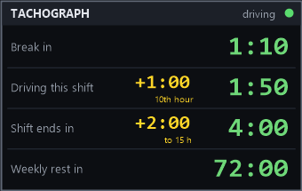
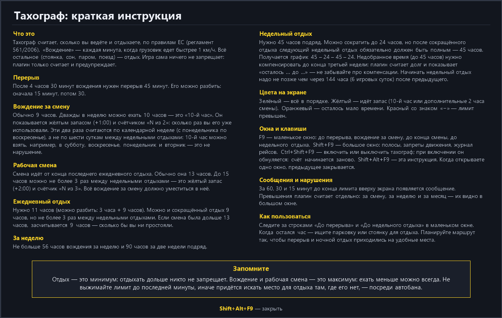
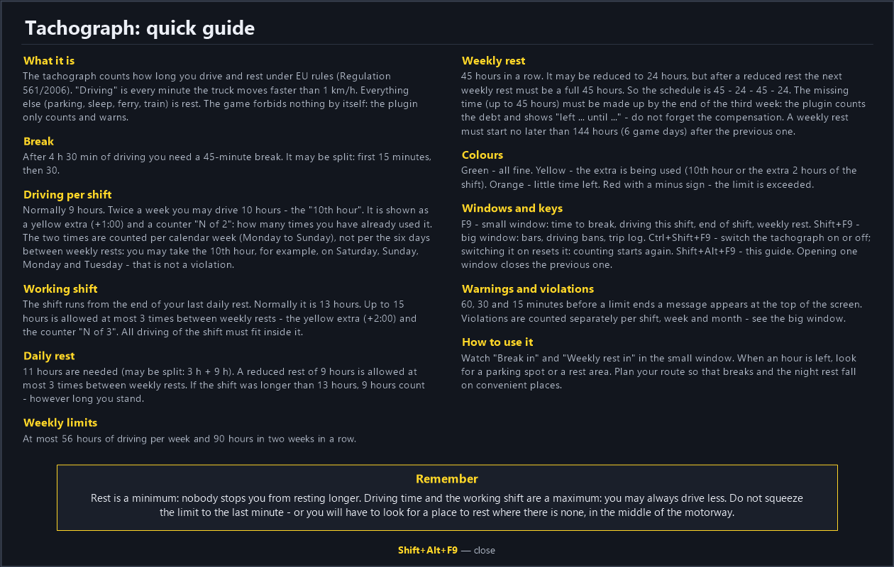

# DriverDesk — рабочее место дальнобойщика для ETS2 и ATS
# DriverDesk — a trucker's desk for ETS2 and ATS

**Почувствуйте себя настоящим дальнобойщиком в Европе.** DriverDesk превращает рейс в настоящую рабочую неделю: вы следите за временем вождения и отдыха по правилам ЕС, планируете маршрут с учётом запретов движения грузовиков в праздники и выходные в разных странах и решаете, где встать на перерыв и недельный отдых. Каждая смена, каждый час отдыха и каждый рейс — на счету, как у настоящих водителей.

**Feel like a real long-haul trucker in Europe.** DriverDesk turns every job into a real working week: you watch your driving and rest time under EU rules, plan your route around truck driving bans on holidays and weekends in different countries, and decide where to take your break and weekly rest. Every shift, every hour of rest and every trip counts, just like for real drivers.

Плагин для одиночной игры **Euro Truck Simulator 2** и **American Truck Simulator** (Windows; Steam Deck — через Proton).
По одной клавише (**Shift+F9**) поверх игры открывается окно: календарь с реальной датой и праздниками, тахограф (ETS2) или логбук HOS (ATS), запреты движения грузовиков в Европе, путевой журнал с прибылью и расходами и ТО. Клавиша **F9** — маленькое окно тахографа, **Shift+Alt+F9** — инструкция по правилам.

A single-player plugin for **Euro Truck Simulator 2** and **American Truck Simulator** (Windows; Steam Deck through Proton).
One key (**Shift+F9**) opens a window over the game: a calendar with a real date and holidays, a tachograph (ETS2) or an HOS logbook (ATS), truck driving bans in Europe, a trip log with profit and expenses, and maintenance. **F9** opens a small tachograph window, **Shift+Alt+F9** a rules guide.

> **Важно / Note.** Это не мод `.scs`, а плагин `.dll`: его нельзя выложить в Мастерскую Steam, только скачать отсюда. Версия 1.3.
> This is a `.dll` plugin, not an `.scs` mod, so it is not on the Steam Workshop. Version 1.3.
>
> **Что нового в 1.3 / New in 1.3:**
> - **Мини-окно (F9)** теперь с четырьмя строками: до перерыва, вождение за смену, до конца смены, до недельного отдыха. Жёлтый запас («+1:00 — 10-й час», «+2:00 до 15 ч») показывается отдельно; сверху справа мелко — сколько отдыха уже набрано. / **Mini window (F9)** now has four rows: time to the break, driving this shift, shift end, weekly rest. The amber reserve ("+1:00 — 10th hour", "+2:00 to 15 h") is shown separately; the top right shows how much rest you have already taken.
> - **10-й час и смены до 15 ч**: в большом окне счётчики «N из 2» (10-й час, по календарной неделе) и «N из 3» (смена до 15 ч). Правило ETS2: после смены дольше 13 ч отдых засчитывается как 9 ч. / **10th hour and shifts up to 15 h**: counters "N of 2" (10th hour, per calendar week) and "N of 3" (shift up to 15 h). ETS2 rule: after a shift longer than 13 h the rest counts as 9 h.
> - **Блок отдыха** в большом окне: сколько нужно (11 или 9 ч), сколько осталось, счёт идёт и после 11 ч (ATS: перерыв 30 мин, 10 ч, 34 ч). / **Rest block** in the main window: how much is required (11 or 9 h), how much is left (ATS: 30-min break, 10 h, 34 h).
> - **Журнал с финансами**: прибыль за месяц, расходы (топливо по ценам стран/штатов, штрафы, дороги и паромы), остаток и строка по каждому рейсу. Баланс банка и покупки игра плагину не отдаёт. / **Trip log with finances**: monthly profit, expenses (fuel at country/state prices, fines, tolls and ferries), the balance and a line for every trip. The bank balance and purchases are not available to plugins.
> - **Синхронизация между устройствами** (ПК и Steam Deck): данные профиля дублируются в `DriverDesk_data.ini` в папке профиля игры (Steam Cloud) и сливаются при загрузке. Нужна версия 1.3 на каждом устройстве. / **Sync between devices** (PC and Steam Deck): profile data is also kept in `DriverDesk_data.ini` in the game profile folder (Steam Cloud) and merged on load. Version 1.3 is needed on every device.
> - **Инструкция** на экране (**Shift+Alt+F9**): правила ЕС / HOS, цвета, клавиши. / An on-screen **guide** (**Shift+Alt+F9**): EU / HOS rules, colours, keys.
> - **Новые сообщения** за 1 час до конца вождения за смену и до конца рабочей смены; счётчик нарушений за смену, неделю и месяц. / **New notices** 1 hour before the end of driving for the shift and of the working shift; violation counter per shift, week and month.
> - Исправлено: после включения тахографа смена начиналась сразу — теперь с первой минуты вождения. / Fixed: after switching the tachograph on the shift started at once, now it starts with the first minute of driving.
> - **Клавиша тахографа изменена с Alt+F9 на Ctrl+Shift+F9.** Открытое окно закрывает другое. / **The tachograph key changed from Alt+F9 to Ctrl+Shift+F9.** Opening one window closes another.
>
> **Клавиши / Keys:** **Shift+F9** — большое окно / main window; **F9** — мини-окно / mini window; **Ctrl+Shift+F9** — тахограф (HOS) вкл/выкл (при включении обнуляется) / tachograph (HOS) on/off (resets when switched on); **Shift+Alt+F9** — инструкция / guide.
>
> **Мои моды в Steam / My mods on Steam:** [Euro Truck Simulator 2](https://steamcommunity.com/sharedfiles/filedetails/?id=3824174228) · [American Truck Simulator](https://steamcommunity.com/sharedfiles/filedetails/?id=3826454951)

---

## Скриншоты / Screenshots

> Это пример окна на тестовых данных (рисуется самим плагином), а не снимок из игры. / A sample window with test data rendered by the plugin itself, not an in-game capture.

**ETS2** — календарь с днями запрета (красные рамки), тахограф, запреты в стране и у соседей, строка о грузе, журнал и ТО.

| Русский | English |
|---|---|
|  |  |

**ATS** — календарь, логбук HOS, журнал и ТО (мили, галлоны).

| Русский | English |
|---|---|
|  |  |

**Мини-окно тахографа (клавиша F9) / Mini tachograph window (F9)** — слева вверху экрана, в стиле тахографа. / Top-left corner of the screen, tachograph style.

| ETS2, русский | ETS2, English | ATS, English |
|---|---|---|
|  |  |  |

**Инструкция (Shift+Alt+F9) / Guide (Shift+Alt+F9)**

| Русский | English |
|---|---|
|  |  |

---
## Что умеет / Features

| | ETS2 | ATS |
|---|---|---|
| Календарь, часовой пояс страны/штата, праздники / Calendar, time zone, holidays | ✔ | ✔ |
| Тахограф ЕС 561/2006 / EU tachograph | ✔ | — |
| Логбук HOS (FMCSA) / US HOS logbook | — | ✔ |
| Запреты движения грузовиков, исключения для грузов / Truck bans, cargo exemptions | ✔ | — |
| Путевой журнал, расход топлива / Trip log, fuel | ✔ | ✔ (мили, галлоны) |
| ТО по пробегу / Maintenance by mileage | ✔ | ✔ |
| Мини-окно тахографа (F9) / Mini tachograph window (F9) | ✔ | ✔ |
| Инструкция на экране (Shift+Alt+F9) / On-screen guide | ✔ | ✔ |
| Журнал: прибыль, расходы, остаток / Log: profit, expenses, balance | ✔ | ✔ |
| Синхронизация ПК ↔ Steam Deck / PC ↔ Steam Deck sync | ✔ | ✔ |
| Счётчик нарушений за смену, неделю, месяц / Violation counter: shift, week, month | ✔ | ✔ |
| Сообщения на экране (за 60, 30 и 15 минут) / On-screen notices (60, 30 and 15 min) | ✔ | ✔ |

## Календарь / Calendar

**Зачем.** В играх нет настоящего календаря: идут часы и дни недели, но нет числа и месяца. Календарь сопоставляет игровые дни с реальными датами, чтобы вы знали, **какое сегодня число, какой день недели и какой праздник** в стране, где стоит грузовик. Это нужно для запретов движения (они привязаны к воскресеньям, праздникам и летним субботам), для тахографа (неделя считается по календарю) и просто для атмосферы.

**Как работает.** У каждого профиля игры своя дата: при первом запуске она берётся из `new_profile_date` в настройках (по умолчанию 1 июля), потом идёт сама вместе с игровым временем. День недели в календаре всегда совпадает с игрой. Время показывается **по часовому поясу той страны или штата, где сейчас грузовик** (страна определяется по ближайшему городу). Праздники страны — оранжевые числа, красные рамки — дни запрета движения грузовиков (ETS2). **Праздники.** В ETS2 — праздники стран Европы (с названиями, в том числе религиозные, от Пасхи). В ATS — **федеральные праздники США и праздники отдельных штатов**: например, День независимости Техаса и Сан-Хасинто в Техасе, Nevada Day в Неваде, Pioneer Day в Юте, Mardi Gras в Луизиане, César Chávez Day в Калифорнии. Названия — на языке игры (9 языков), в календаре — оранжевые числа и список под сеткой. Если праздник выпадает на выходной, перенос на понедельник/пятницу не учитывается. Месяцы листаются **поворотниками** (левый — назад, правый — вперёд). Когда наступает другое время года, на экране появляется сообщение — например, чтобы подключить зимний мод на графику.

**What it is for.** The games have no real calendar: you get the clock and the weekday, but no day of the month. The calendar maps game days to real dates so you know the date, weekday and **public holiday in the country where your truck is**. Bans, the tachograph week and seasons all depend on it. Each profile has its own date; the time follows the **time zone of the country/state you are in**. Months are flipped with the turn signals. Holidays: European national holidays in ETS2; US federal and state-specific holidays in ATS (e.g. Texas Independence Day, Nevada Day, Pioneer Day in Utah, Mardi Gras in Louisiana); an observed day off when a holiday falls on a weekend is not modelled.

## Тахограф ЕС (ETS2) / EU tachograph (ETS2)

Упрощённая модель регламента ЕС 561/2006. Плагин считает «вождением» каждую игровую минуту, когда грузовик едет быстрее 1 км/ч, а всё остальное время (стоянка, сон, паром, поезд) — отдыхом.

| Режим / Rule | Лимит / Limit |
|---|---|
| Непрерывное вождение / Continuous driving | 4 ч 30 мин → перерыв 45 мин (или 15 + 30) |
| Дневное вождение / Daily driving | 9 ч, дважды в неделю можно 10 ч |
| Смена (окно) / Shift window | 24 ч минус ежедневный отдых: **13 ч** при отдыхе 11 ч или **15 ч** при сокращённом 9 ч (не более 3 раз между еженедельными); вождение 9/10 ч должно уместиться в смену |
| За неделю / Per week | 56 ч |
| За две недели подряд / Per two weeks | 90 ч |
| Ежедневный отдых / Daily rest | 11 ч (или 3 + 9), сокращённый 9 ч — не более 3 раз между еженедельными отдыхами |
| Еженедельный отдых / Weekly rest | 45 ч или сокращённый 24 ч (после сокращённого — обязательно 45 ч); начать не позже чем через 6 × 24 ч |

**Выключить тахограф** (в ATS — логбук HOS) можно кнопкой **Ctrl+Shift+F9**: счёт и сообщения отключаются, при включении счёт начинается заново; состояние запоминается, клавишу можно поменять в `DriverDesk.ini` (`tachograph_key`). В окне — полосы с остатком времени и подсказки «начать отдых до …». Если прошлый еженедельный отдых был **сокращённым (24 ч)**, плагин пишет «следующий — обязательно полный 45 ч», во время отдыха показывает, **сколько осталось до 45 часов**, а если игрок снова отдохнёт меньше 45 часов, выводит красное предупреждение. **Компенсация:** недобранное до 45 ч время нужно компенсировать **не позднее конца третьей недели** после недели сокращённого отдыха. Плагин считает долг, показывает «осталось H:MM до <срок>» (оранжевым, красным — если срок вышел) и зачитывает излишек отдыха: сверх 45 ч у еженедельного или сверх 11 ч у ежедневного отдыха (компенсацию можно присоединить к любому отдыху от 9 ч). На экране появляются сообщения: за 30 минут до перерыва, при превышении 4:30, за 1 час до конца окна смены, за 15 минут до конца дневной нормы, при превышении нормы, **за 1 час до еженедельного отдыха** (если прошлый был сокращённым — «обязательно 45 часов», иначе «можно 24 или 45 часов»; при долге по компенсации дописывается, сколько осталось), **за 1 час до лимита 56 часов в неделю и 90 часов за две недели** и когда пора на еженедельный отдых. В ATS (HOS) перерыв — за 30 минут, 11 часов вождения и окно 14 часов — за 1 час.

**Версия 1.1:** новые сообщения о перерыве, окне смены, еженедельном отдыхе и лимитах 56/90 часов (см. выше).

**Версия 1.2 — ещё по одному сообщению за 15 минут:** до обязательного перерыва (конец 4:30 вождения), до конца окна смены, до начала еженедельного отдыха и до лимита 56 часов в неделю. В ATS (HOS): до перерыва, до конца 11 часов вождения, до конца окна 14 часов и до конца цикла 70 часов (потом нужен отдых 34 часа). Каждое сообщение показывается один раз за эпизод. / **Version 1.2 — one more warning 15 minutes before:** the required break (end of 4:30 driving), the end of the shift window, the weekly rest and the 56 h weekly limit. ATS (HOS): the break, the end of 11 h driving, the end of the 14 h window and the end of the 70 h cycle (a 34 h restart is needed after it). Each warning is shown once per episode.

### Мини-окно тахографа (F9) / Mini tachograph window (F9)

Маленькое окно **слева вверху** экрана в стиле тахографа (тёмная панель, янтарные цифры). Открывается и закрывается клавишей **F9** (без Shift/Ctrl/Alt; клавишу можно поменять строкой `mini_window` в `DriverDesk.ini`). Показывает три времени:
- **До конца смены** — окно смены: ETS2 13 или 15 ч, ATS 14 ч;
- **До перерыва** — ETS2 до конца 4:30 вождения, ATS до конца 8 ч без перерыва;
- **До недельного отдыха** — ETS2: сколько осталось до конца 144 часов после прошлого еженедельного отдыха; ATS: сколько осталось из 70 часов за 8 дней (потом нужен отдых 34 часа).

**С версии 1.3** строк четыре: до перерыва, вождение за смену (с жёлтым запасом «+1:00», «10-й час»), до конца смены (с запасом «+2:00 до 15 ч») и до недельного отдыха. Зелёные цифры — всё в норме, жёлтые — идёт запас (большие цифры стоят «0:00», отсчитывается запас), **оранжевые** — мало времени до перерыва или недельного отдыха, **красные со знаком «−»** — лимит превышен. Справа вверху мелко — «отдых 0:20 / 0:45» (сколько отдыха набрано и сколько нужно). Справа вверху — «в пути» или «отдых H:MM»; если тахограф выключен (Ctrl+Shift+F9) — «выключен». Подсказка про клавишу F9 есть и в большом окне, внизу.

A small tachograph-style window in the **top-left corner** of the screen (dark panel, amber digits), opened and closed with **F9** (no modifiers; change the `mini_window` line in `DriverDesk.ini`). It shows three times: **time to the end of the shift** (shift window: 13/15 h in ETS2, 14 h in ATS), **time to the break** (end of 4:30 of driving in ETS2, 8 h without a break in ATS) and **time to the weekly rest** (ETS2: what is left of the 144 h after the previous weekly rest; ATS: what is left of the 70 h in 8 days, after which a 34 h restart is needed). Digits turn orange when little time is left (under 1 h for the shift and the weekly rest, under 30 min for the break) and red with a minus sign when the time is over. The top-right shows "driving" or "rest H:MM", or "off" when the tachograph is switched off (Ctrl+Shift+F9). **Since 1.3** it has four rows: break, driving this shift (with an amber reserve "+1:00", "10th hour"), shift end (with a "+2:00 to 15 h" reserve) and weekly rest. Green = normal, amber = a reserve is being used, orange = little time left, red with a minus = limit exceeded.

### Нарушения режима труда и отдыха / Driving and rest time violations

В большом окне, **под показаниями тахографа** (в ATS — под логбуком HOS), три счётчика: нарушения **за смену, за неделю и за месяц** (красные, если больше нуля). Каждое превышение лимита считается **один раз за эпизод**, и только пока вы едете.
- **ETS2:** больше 4:30 без перерыва, превышение дневного вождения, выход за окно смены, больше 56 ч за неделю, больше 90 ч за две недели, еженедельный отдых не начат за 144 часа, снова сокращённый еженедельный отдых подряд, просрочена компенсация.
- **ATS:** больше 8 часов без перерыва, больше 11 часов вождения, выход за окно 14 часов, превышение цикла 70 часов.

Счётчик смены обнуляется новым ежедневным отдыхом (в ATS — отдыхом 10 часов), недельный — со сменой недели, месячный — со сменой месяца в календаре игры. Данные хранятся по профилям в `DriverDesk_data.ini`; при включении тахографа кнопкой Ctrl+Shift+F9 счётчики обнуляются.

Under the tachograph readings (under the HOS logbook in ATS) the main window shows three counters: violations **per shift, per week and per month** (red when above zero). Each exceeded limit is counted **once per episode**, and only while driving. ETS2: more than 4:30 without a break, the daily driving limit, the shift window, 56 h per week, 90 h per two weeks, the weekly rest not started within 144 h, a reduced weekly rest twice in a row, a missed compensation deadline. ATS: more than 8 h without a break, more than 11 h of driving, the 14 h window, the 70 h cycle. The shift counter resets with a new daily rest (10 h off duty in ATS), the weekly one when the week changes, the monthly one when the calendar month changes. The data is stored per profile in `DriverDesk_data.ini`; switching the tachograph on with Ctrl+Shift+F9 resets the counters.

## Логбук HOS (ATS) / HOS logbook (ATS)

Американский аналог тахографа (правила FMCSA для грузовиков, перевозящих грузы): **11 часов** вождения за смену, **окно смены 14 часов** (идёт без остановки с первой минуты вождения после отдыха), перерыв **30 минут** после 8 часов вождения, **70 часов за 8 дней**. **10 часов** отдыха сбрасывают смену, **34 часа** — цикл 70/8. Упрощено: в смене считается только вождение; режимы «спальное место» и «личное пользование» не учитываются.

The US counterpart of the tachograph (FMCSA rules for property-carrying drivers): 11 h driving per shift, a 14-hour shift window, a 30-min break after 8 h of driving, 70 h in 8 days; 10 h off duty resets the shift, 34 h resets the cycle. Sleeper-berth split and personal conveyance are not modelled.

## Запреты движения грузовиков (ETS2) / Truck driving bans (ETS2)

**Зачем.** В Европе в воскресенья, праздники, а в ряде стран и по субботам летом тяжёлым грузовикам (> 7,5 т) нельзя ехать — иначе штраф. Плагин показывает это заранее, чтобы вы не встали на границе на сутки.

**Как работает.** По положению грузовика плагин определяет страну и показывает в окне блоки:
- **«Здесь»** — запреты сегодня и завтра, ближайший запрет в ближайшие 14 дней, праздники с названиями («15.08 — Успение: 00:00–22:00»). Идущий сейчас запрет подсвечен красным.
- **«Соседние страны»** — кратко по каждой соседней стране (международный код: D, A, I, F, PL …): запрет сегодня и завтра. Пригодится заранее выбрать маршрут.
- **«Пункт назначения»** — запреты в стране, куда вы везёте груз.
- Календарь отмечает дни запрета красной рамкой; ежедневные ночные запреты (Швейцария, Австрия, Черногория) идут отдельной строкой.
- За **30 минут до начала запрета** приходит сообщение на экран.

Данные есть по **Германии, Австрии, Швейцарии, Франции, Италии, Польше, Чехии, Словакии, Венгрии, Словении, Хорватии, Люксембургу и Черногории**. Для Испании показываются праздники и отдельные участки в особые дни, для Португалии — только ADR, для Лондона — зона LLCS; в Великобритании, Болгарии и Румынии общих запретов нет.

### На какие грузы запрет не распространяется / Cargo exemptions

В большинстве стран запрет **не касается** части грузов. Плагин смотрит, какой груз у вас в рейсе, и **в окне Shift+F9 (в разделе «Запреты движения», в любой стране, в том числе там, где запретов нет, например в Испании) пишет одну строку**: «Груз: Говядина — запрет не действует» (зелёная) или «Груз: Игрушки — запрет действует» (красная). Если груз из списка исключений, **сообщения о запрете не приходят** — вы едете без лишних отвлечений.

Освобождены (в игре около 80 грузов) в первую очередь:
- **скоропортящиеся продукты** — мясо, птица, рыба, молочные продукты и сыры, овощи, фрукты, цветы, вакцины;
- **молоко** (в цистерне и в тенте);
- **живые животные** — скот, свиньи, овцы;
- **опасные грузы (ADR)** — топливо, газы, кислоты и щёлочи, химикаты, взрывчатка, медицинские отходы и т. п.;
- **почта и авиапочта**.

Исключение — **Швейцария**: там запрет действует **для всех грузов без исключений** (нужно особое разрешение), поэтому для неё плагин всегда показывает «запрет для всех грузов».

Список — по правилам стран и отметкам автора, он упрощён: на деле условия зависят от страны, веса груза и пробега.

---

## Путевой журнал и ТО / Trip log and maintenance

- **Журнал:** каждый рейс — груз, откуда и куда, расстояние, доход, штрафы, платные дороги и паромы, расход топлива (л/100 км или миль/галлон) за рейс и за месяц, порожний пробег. В ATS — мили и галлоны США.
- **ТО по пробегу:** масло и фильтры, топливный и воздушный фильтры, тормоза, масло КПП и мостов, годовой техосмотр (в ETS2 ещё поверка тахографа). Счётчик сбрасывается, когда вы ремонтируете износ детали в сервисе.

## Совет: вместе с плагином на ходьбу / Tip: use it together with a walking plugin

**RU.** Для более реалистичной и удобной игры советую ставить DriverDesk вместе с плагином на ходьбу **TM Real Walk** (автор Izuan Bakar, TM Modding Studio; сторонний платный плагин, к DriverDesk отношения не имеет). По описанию автора, в нём есть **сон в любом месте**: режим отдыха в кабине (по умолчанию Shift+R), и можно спать на любой парковке. Поэтому **перерывы и еженедельные отдыхи можно делать там, где вам удобно**, а DriverDesk при этом считает время тахографа и подсказывает, когда пора остановиться и сколько ещё нужно отдохнуть. Плагины работают независимо и не мешают друг другу: клавиши DriverDesk — Shift+F9, F9, Ctrl+Shift+F9 и Shift+Alt+F9, у TM Real Walk — F8, F10 и их сочетания.

**EN.** For a more realistic and more convenient game I recommend using DriverDesk together with the walking plugin **TM Real Walk** (by Izuan Bakar, TM Modding Studio; a third-party paid plugin, not related to DriverDesk). According to its author it includes **sleeping anywhere**: a rest mode in the cab (Shift+R by default) that lets you sleep in any parking spot. So you can take **breaks and weekly rests wherever it suits you**, while DriverDesk tracks the tachograph time and tells you when to stop and how much rest is still needed. The two plugins are independent and do not conflict: DriverDesk uses Shift+F9, F9, Ctrl+Shift+F9 and Shift+Alt+F9, TM Real Walk uses F8, F10 and their combinations.

## Совет: мод на экономику со сроками доставки / Tip: an economy mod with longer delivery deadlines

**RU.** С тахографом (перерывы 45 минут, отдых 11 часов, недельный отдых) в стандартные сроки доставки, которые задали разработчики игры, успевать трудно. Советую поставить мод на экономику, который **добавляет или увеличивает срок доставки** и делает его точнее, например мои моды: [экономика ETS2](https://steamcommunity.com/sharedfiles/filedetails/?id=3823572046) и [экономика ATS](https://steamcommunity.com/sharedfiles/filedetails/?id=3826293113) в Мастерской Steam. Можно взять и любой другой мод с похожим действием.

**EN.** With a tachograph (45-minute breaks, 11 h daily rest, weekly rest) it is hard to make it to the unloading within the standard delivery deadlines set by the game developers. I recommend an economy mod that **adds or lengthens the delivery time** and makes it more accurate, for example my mods: [economy for ETS2](https://steamcommunity.com/sharedfiles/filedetails/?id=3823572046) and [economy for ATS](https://steamcommunity.com/sharedfiles/filedetails/?id=3826293113) on the Steam Workshop. Any other mod that does the same will work too.

## Установка / Installation

1. Скопируйте `DriverDesk.dll` в папку / Copy `DriverDesk.dll` to:
   - ETS2: `…\Euro Truck Simulator 2\bin\win_x64\plugins\`
   - ATS: `…\American Truck Simulator\bin\win_x64\plugins\`

   Если папки `plugins` нет — создайте. Один и тот же файл подходит для обеих игр / The same file works for both games.
2. Запустите игру. Рядом появятся `DriverDesk.ini` (настройки) и `DriverDesk_data.ini` (ваши данные: журнал, тахограф, ТО).
3. Нажмите **Shift+F9** / Press **Shift+F9**.

**Steam Deck:** та же папка `bin/win_x64/plugins`, запуск игры через Proton (не родная Linux-версия).

**Удаление / Uninstall:** удалите три файла `DriverDesk*` из `plugins`.

## Важно / Notes

- Только одиночная игра, **не для TruckersMP**. / Single-player only, **not for TruckersMP**.
- Игра не передаёт плагину погоду и страну: страна определяется по ближайшему городу, у границы возможны ошибки. / The country is taken from the nearest city, so it may be wrong near a border.
- Запреты, праздники, исключения и правила тахографа и HOS **упрощены и ориентировочны**, это не юридическая консультация. / Bans, holidays, exemptions, tachograph and HOS rules are **simplified and approximate**; this is not legal advice.
- DLL не подписана цифровой подписью, антивирус может предупредить о неизвестном файле. / The DLL is not code-signed; an antivirus may warn about it.

## Настройки / Settings (`DriverDesk.ini`)

Клавиши (`open`, `mini_window`, `tachograph_key`, `help_window`), вид мини-окна (`mini_style`), цена топлива (`fuel_price`), размер и положение окна, поправка времени, дата начала для нового профиля — в файле каждая строка с пояснением. / Keys (`open`, `mini_window`, `tachograph_key`, `help_window`), mini window style (`mini_style`), fuel price (`fuel_price`), window size and position, time shift, start date for a new profile — every line is commented.

## Связь с автором / Contact

Сообщения об ошибках и предложения — в разделе [Issues](https://github.com/aleksandrstaryi/driverdesk/issues) этого репозитория. / Bug reports and suggestions: please use [Issues](https://github.com/aleksandrstaryi/driverdesk/issues) in this repository.

## Лицензия / License

© Staryi, все права защищены. Исходный код закрыт; распространять DLL можно только в неизменном виде со ссылкой на эту страницу. Это неофициальный плагин, он не связан с SCS Software. / All rights reserved. The source code is not published; the DLL may be redistributed only unmodified, with a link to this page. Unofficial plugin, not affiliated with SCS Software.
